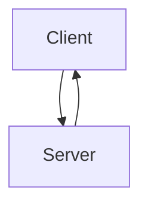
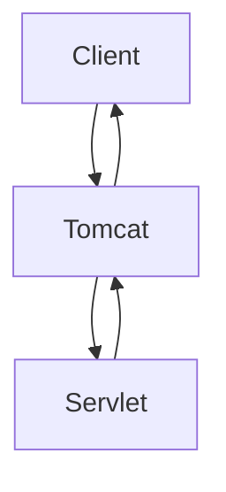
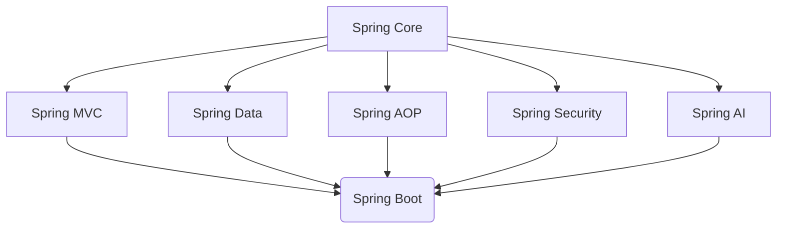

# Spring Framework



## Client Server Architecture
Client Makes a `Request` (HTTP/HTTPS) to the Server
and the Server gives a `Response`.

Client
- Mobile App
- Broswer
- React Frontend
- Postman
- Server (if it calls another server)

Server Authenticates, Processes and Responds to the Request.

### HTTP -> Hyper Text Transfer Protocol
Rulebook defining the structure of response/request and the methods (GET/POST/DELETE/PATCH/PUT)
and how data will be sent.

### HTTPS -> Hyper Text Transfer Protocol Secure
Encrypts the Response/Request.

Request Structure:
- Method Name (GET/POST)
- API Endpoint/Path/URL
- Headers
- Body

Examples:
```bash
GET /courses
HOST: www.example.com

POST /login
HOST: www.example.com
Content-Type: application/json
{
    email: "example@gmail.com",
    password: "pass"
}
```

Response Structure:
- Status Code (200 OK, 201, 503 Internal Server Error, 404 Resource Not Found)
- Headers
- Body

Example:
```bash
200 OK
Content-Type: application/json
{
    message: "success"
}
```

## Why Spring?
You can do Everything directly with `java.net` packages's socket but
then you'll have to manually parse requests, and create responses,
manually allocate endpoints to methods and handle multi threading/concurrency.
NOTE: Not necessarily Java, Any language with networking support can work.

Then came Servlet and Servlet Containers that make this easier.
- Apache Tomcat
- Jetty
- Undertow



Client Sends Request to Tomcat Server which handles parsing, concurrency etc.
and Sends a HTTP Servlet Request to a Java Servlet (Code) which replies with
HTTP Servlet Response to Tomcat which then replies back to the Client.

Then Came Spring Framework, since on Enterprise level Applications things became
tightly coupled and hard to maintain so Spring introduces it's rules to de-couple
the code and make it easier to maintain.

## Spring Architecture


Spring Data:
- JDBC (Write SQL Queries)
- JPA (Internally depends on Hibernate which depends on JDBC)