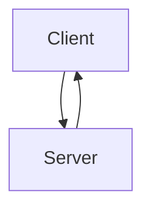
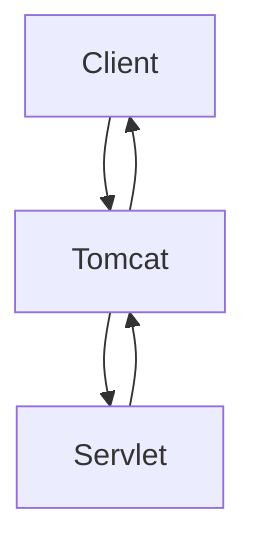
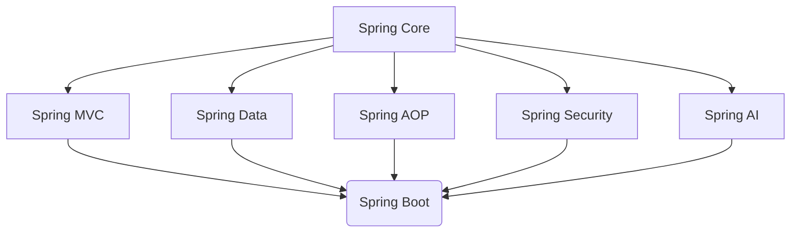
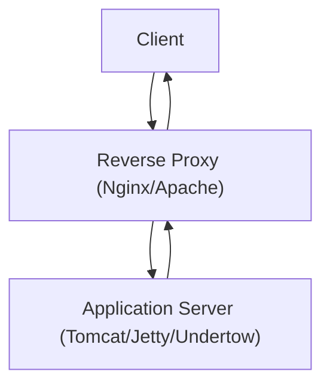

# Spring Framework

## Client–Server Architecture



A **client** sends a `Request` (HTTP/HTTPS) to a **server**, and the server returns a `Response`.

### Examples of clients

- Mobile app
- Browser
- React frontend
- Postman
- Another server, when it calls this server

The server authenticates the request, processes it, and sends a response.

### HTTP — Hypertext Transfer Protocol

HTTP is the rulebook that defines the structure of requests and responses, the methods used (GET, POST, DELETE, PATCH, PUT), and how data is sent.

### HTTPS — Hypertext Transfer Protocol Secure

HTTPS encrypts HTTP request and response traffic in transit.

### HTTP request structure

- **Method:** for example, `GET` or `POST`
- **API endpoint/path/URL**
- **Headers**
- **Body** (when needed)

#### Examples

```http
GET /courses
Host: www.example.com
```

```http
POST /login
Host: www.example.com
Content-Type: application/json

{
    "email": "example@gmail.com",
    "password": "pass"
}
```

### HTTP response structure

- **Status code:** for example, `200 OK`, `201 Created`, `404 Not Found`, or `503 Service Unavailable`
- **Headers**
- **Body**

#### Example

```http
200 OK
Content-Type: application/json

{
    "message": "success"
}
```

## Why Spring?

You can do everything directly with sockets from Java's `java.net` packages. However, you would then have to:

- Manually parse requests.
- Create responses.
- Map endpoints to methods.
- Handle multithreading and concurrency.

**Note:** This is not specific to Java. Any language with networking support can do this.

### Servlets and servlet containers

Servlets and servlet containers make this work easier. Examples of servlet containers include:

- Apache Tomcat
- Jetty
- Undertow



The client sends a request to the Tomcat server. Tomcat handles request parsing, concurrency, and other server responsibilities. It then sends an HTTP Servlet Request to a Java Servlet (your code). The servlet returns an HTTP Servlet Response to Tomcat, which sends the HTTP response back to the client.

### Spring Framework

As enterprise-level applications grew, code often became tightly coupled and difficult to maintain. Spring Framework introduced conventions and tools that help decouple code and make applications easier to maintain.

## Spring Architecture



### Spring Data

- **JDBC:** Write SQL queries.
- **JPA:** Uses Hibernate internally; Hibernate, in turn, uses JDBC.

## Default Ports

- **HTTP:** `80`
- **HTTPS:** `443`

Applications can use other ports as well. For example, a Spring Boot application commonly runs on port `8080` during development.

How does a client reach an application that listens on a different port?



The client sends a request to the reverse proxy, which listens on port `80` or `443`. The reverse proxy forwards the request to the application server, which listens on port `8080`. The application server processes the request and sends the response back to the reverse proxy, which then returns it to the client.

## Setting Up a Maven Project

Go to [`start.spring.io`](https://start.spring.io/) or use the Spring Initializr extension in VS Code. Use these settings:

- **Project:** Maven (rather than Gradle)
- **Language:** Java
- **Spring Boot version:** `4.0.0` or higher
- **Group:** `com.example`
- **Artifact:** `demo`
- **Package name:** `com.example.demo`
- **Packaging:** Jar
- **Java:** 21 LTS

For a Java web application, the setup automatically:

- Creates the folder structure.
- Creates the configuration files.
- Downloads the dependencies.
- Configures the Java version.
- Configures the Spring Boot version.
- Sets up the package structure.

## Mapping URLs to Methods with `@GetMapping`

- `@GetMapping("/")` maps the `/` path to the annotated method. For example, `http://localhost:8080/` displays that method's result.
- `@GetMapping("hello")` maps the `/hello` path to the annotated method. For example, `http://localhost:8080/hello` displays that method's result.
