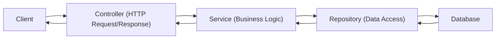

## My setup
- VS Code
- Java 21 (Eclipse Temurin Adoptium)
- Spring Boot Extension Pack (VS Code)
- Maven wrapper (mvnw)
- curl.exe
- PostgreSQL 18 (Host Port: 5432)

## Spring Boot Dependencies
- Spring Boot Web
- postgresql driver
- Spring Data JPA

### Example of Curl commands to test API endpoints

```bash
curl -X POST http://localhost:8080/api/users
-H "Accept: application/json"
-H "Content-Type: application/json"
-d '{"name":"John Doe","email":"john.doe@example.com"}'
```

curl basics:
-X : Specifies the HTTP method to use (e.g., GET, POST, PUT, DELETE).
-H : Adds a header to the request (e.g., Content-Type).
-d : Sends data in the request body (e.g., JSON payload).

# CRUD Application with Spring Boot

- Create ---> POST
- Read ---> GET
- Update ---> PUT
- Delete ---> DELETE

API Endpoints can be tested using Postman or curl commands.


## Configure Properties
- Open `application.properties` file in `src/main/.../resources/` and add the following properties:

```properties
spring.datasource.url=jdbc:postgresql://localhost:5432/your_database_name
spring.datasource.username=your_username
spring.datasource.password=your_password
spring.jpa.hibernate.ddl-auto=update
spring.jpa.show-sql=true
spring.jpa.properties.hibernate.dialect=org.hibernate.dialect.PostgreSQLDialect
```

## Class Structure Convention
- `Controller` class: Handles HTTP requests and responses.
- `Service` class: Contains business logic and interacts with the repository layer.
- `Repository` class: Handles database operations and data access.
- `Model / Entity` class: Represents the data structure and maps to database tables.



eg: `StudentController` class handles HTTP requests, `StudentService` class contains business logic, and `StudentRepository` class interacts with the database. and `Student` class represents the data structure for a student entity.

The Client sends a json request which is converted to a Java object by the Controller class.
The Controller class then calls the Service class to process the request.
The Service class interacts with the Repository class to perform database operations.
The Repository class retrieves data from the database and returns it to the Service class,
which then sends it back to the Controller class. Finally, the Controller class converts the Java object
back to a json response and sends it back to the Client.

### ORM Object Relational Model


@Entity -> Annotation that marks a class as a JPA entity, indicating that it should be mapped to a database table. (does not create bean)
@RestController -> Annotation that marks a class as a RESTful controller, indicating that it handles HTTP requests and responses. (creates bean)
@RequestMapping -> Annotation that maps HTTP requests to specific methods in a controller class,
allowing you to define the URL path and HTTP method for each endpoint. (does not create bean)

@PostMapping -> Annotation that maps HTTP POST requests to a specific method in a controller class (does not create bean).
@GetMapping -> Annotation that maps HTTP GET requests to a specific method in a controller class (does not create bean).

NOTE: You can add common API endpoints in RequestMapping. And then add specific endpoints in PostMapping or GetMapping.
```java
@RestController
@RequestMapping("/api/students")
public class StudentController {

    @PostMapping("/xyz")
    public void createStudent(@RequestBody Student student) {
        // Logic to create a new student
    }

}
```

@RequestBody -> Annotation that indicates that a method parameter should be bound to the body of the HTTP request. (does not create bean)
Jackson library is used to convert json request to Java object and vice versa.
@Service -> Annotation that marks a class as a service component, indicating that it contains business logic and
can be injected into other components. (creates bean)
ResponseEntity -> Class that represents an HTTP response, including the status code, headers, and body.
It allows you to customize the response sent back to the client. (does not create bean)